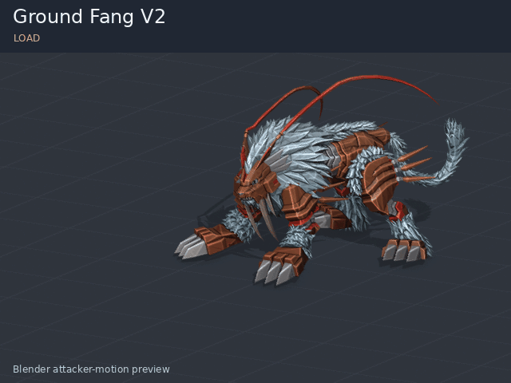
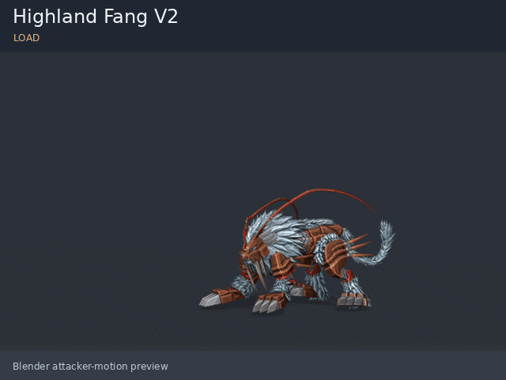

# Dinotigermon — Ground Fang / Highland Fang

**[Download V2 test build](https://github.com/paulpeterkim/DSTSDinotigermonFix/raw/refs/heads/main/downloads/Dinotigermon_Fang_Skills_V2_TEST.zip)**

V2 reworks the attacks around the requested actions. Ground Fang approaches,
plants its forepaws, draws up its fangs, stabs, then wrenches and tears. Highland
Fang coils during a high leap, rotates into a fast fang-led downswing, then
extends its paws to catch the landing.

The original physical attack's approximately 4.14-unit approach is restored.
Ground's planted hold is verified after animation compression; Highland's fangs
lead its forepaws during the cutting stroke. Ground runs for 120 frames and
Highland for 96 at the original approximately 30 fps. Both player/enemy camera
clips match the revised lengths.

## Previews

These show the actual baked Dinotigermon animations in Blender. The floor grid
is a preview aid. Victim reactions are not staged or included.

### Ground Fang

### Highland Fang

## Installation and testing

Install V2 in place of the original Dinotigermon mod. Enable only one copy and
keep the existing Reloaded-II/DSTS.ModLoader dependencies installed.

These files passed binary/data, planted-paw, archive integrity and Blender checks.
They have not been tested in the game. Actual synchronized enemy pinning,
cutting effects, combat spacing, hit timing, camera framing, and return to
formation still need game-side work or testing. In particular, the existing
engine hit setting triggers after the clip; V2 deliberately uses longer clips.
The attacker-only upload has no victim track or paired-event definition.

This edits dacare's uploaded Dinotigermon v1.11.0 mod. The model, textures, skeleton
and V1 skill/text data are preserved. Ground targets one enemy; Highland targets
all enemies. Both retain physical Null damage, power 55, SP 300 and one hit.

## Downloads and notes

- [V2 installation notes, scope and rebuild instructions](downloads/README_V2.md)
- [Editable V2 Blender scene](https://github.com/paulpeterkim/DSTSDinotigermonFix/raw/refs/heads/main/downloads/Dinotigermon_Fang_Attacks_V2.blend)
- [V2 scripts and validation reports](https://github.com/paulpeterkim/DSTSDinotigermonFix/raw/refs/heads/main/downloads/Dinotigermon_Fang_Skills_V2_Source.zip)
- [V1 test build for rollback](https://github.com/paulpeterkim/DSTSDinotigermonFix/raw/refs/heads/main/downloads/Dinotigermon_Fang_Skills_TEST.zip)
- [SHA-256 checksums](downloads/SHA256SUMS.txt)
