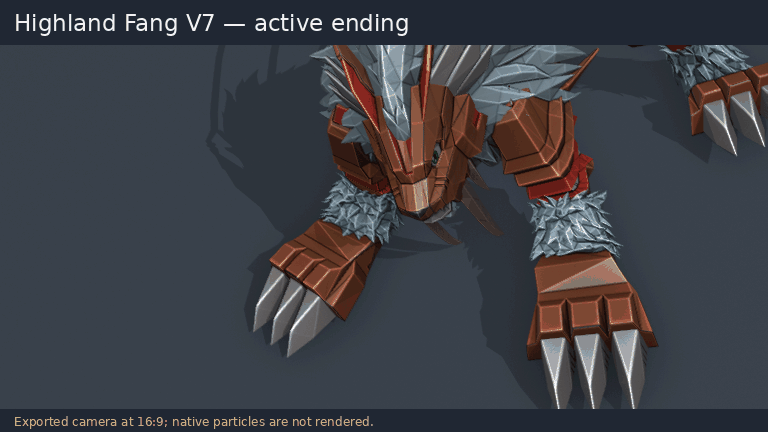
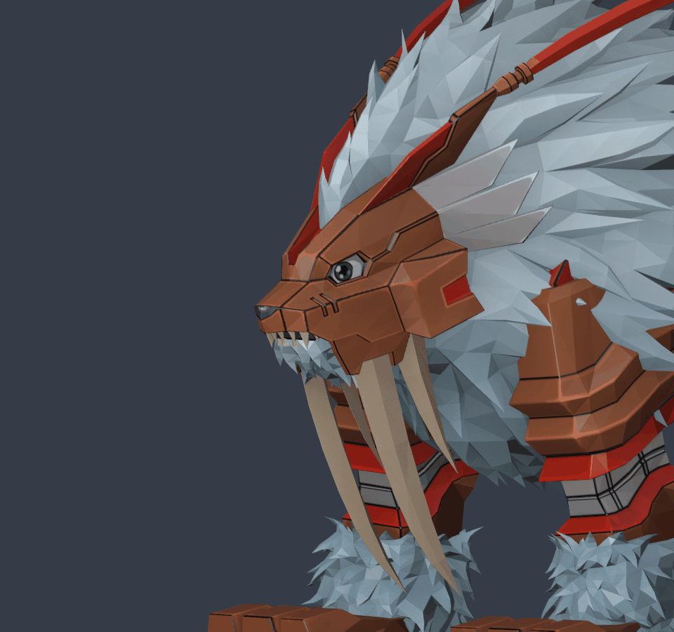

# Dinotigermon — Ground Fang / Highland Fang

**[Download V7 test build](https://github.com/paulpeterkim/DSTSDinotigermonFix/raw/refs/heads/main/downloads/Dinotigermon_Fang_Skills_V7_TEST.zip)**

V7 removes the recovery/idle tails. Ground Fang ends on its final tear and
Highland Fang ends during the landing strike, with both still in attacking
poses. Ground's jaw close-up is retimed to that earlier ending. The retained
motion is unchanged, and the previews have no added pause at the end.
See the [V7 notes](downloads/README_V7.md).

V6 shows both attacks from left to right and keeps the face close-ups during the
bite and downward strike. Ground Fang now ends on a tight jaw shot. Both skills
use description ID `0` for game-generated descriptions; the eleven custom
description overrides are removed and the skill names are retained.
See the [V6 notes](downloads/README_V6.md).

V4 adds the game's Wind Claw effect to Ground Fang and Awesome Quake with a
rock hit to Highland Fang. A short camera shake accompanies Highland's landing.
The accepted V3 actor motions, mouth rig and gameplay parameters are preserved.
Native particle placement and timing require an in-game test; the existing
after-animation hit setting is retained. See the [V4 notes](downloads/README_V4.md)
for exact scope and timing limits.

V3 adds independent shoulder, hip, ankle and toe movement, with smoother takeoff
and landing transitions. It also repairs the lower-jaw skin binding: the mouth
now visibly opens and snaps closed during the bite, while the upper fangs stay
attached to the head.

Ground Fang approaches,
plants its forepaws, draws up its fangs, stabs, then wrenches and tears. Highland
Fang coils during a high leap, rotates into a fast fang-led downswing, then
extends its paws to catch the landing.

The original physical attack's approximately 4.14-unit approach is restored.
Ground's planted hold is verified after animation compression; Highland's fangs
lead its forepaws during the cutting stroke. Ground now runs for 68 frames and
Highland for 48 at the original approximately 30 fps. Both player/enemy camera
clips match those shorter lengths.

## Previews

These show the exported V7 cameras at 16:9 with the active portions of the
preserved actor motion. Victim reactions and native game particles are not
rendered in Blender.

### Ground Fang

### Highland Fang

### Mouth movement

This close-up holds the head still to show the repaired lower jaw opening and
closing independently.

## Installation and testing

Replace the entire old Dinotigermon mod folder with V7 so the removed description
files do not remain. Enable only one copy and
keep the existing Reloaded-II/DSTS.ModLoader dependencies installed.

These files passed binary/data, planted-paw, archive integrity and Blender checks.
They have not been tested in the game. Actual synchronized enemy pinning,
cutting effects, combat spacing, hit timing, camera framing, and return to
formation still need game-side work or testing. In particular, the existing
engine hit setting triggers after the clip; V7 now ends those clips at the attack
instead of including the recovery/idle tail.
The attacker-only upload has no victim track or paired-event definition.

This edits dacare's uploaded Dinotigermon v1.11.0 mod. V3 changes only selected
lower-jaw skin weights in the model; vertex positions, topology, textures,
materials and skeleton are preserved. V4 changes only visual effect references
in the skill data. V6 restores automatic descriptions while preserving the names
and combat parameters.
Ground targets one enemy; Highland targets
all enemies. Both retain physical Null damage, power 55, SP 300 and one hit.

## Downloads and notes

- [V7 notes, installation and rebuild instructions](downloads/README_V7.md)
- [V7 scripts and validation reports](https://github.com/paulpeterkim/DSTSDinotigermonFix/raw/refs/heads/main/downloads/Dinotigermon_Fang_Skills_V7_Source.zip)
- [V6 test build for rollback](https://github.com/paulpeterkim/DSTSDinotigermonFix/raw/refs/heads/main/downloads/Dinotigermon_Fang_Skills_V6_TEST.zip)
- [V6 notes and rebuild instructions](downloads/README_V6.md)
- [V6 scripts and validation reports](https://github.com/paulpeterkim/DSTSDinotigermonFix/raw/refs/heads/main/downloads/Dinotigermon_Fang_Skills_V6_Source.zip)
- [V5 camera test build for rollback](https://github.com/paulpeterkim/DSTSDinotigermonFix/raw/refs/heads/main/downloads/Dinotigermon_Fang_Skills_V5_CAMERA_TEST.zip)
- [V5 camera notes and rebuild instructions](downloads/README_V5.md)
- [V5 scripts and validation reports](https://github.com/paulpeterkim/DSTSDinotigermonFix/raw/refs/heads/main/downloads/Dinotigermon_Fang_Skills_V5_Source.zip)
- [V4 effects test build for rollback](https://github.com/paulpeterkim/DSTSDinotigermonFix/raw/refs/heads/main/downloads/Dinotigermon_Fang_Skills_V4_EFFECTS_TEST.zip)
- [V4 effect notes and rebuild instructions](downloads/README_V4.md)
- [V4 scripts and validation reports](https://github.com/paulpeterkim/DSTSDinotigermonFix/raw/refs/heads/main/downloads/Dinotigermon_Fang_Skills_V4_Source.zip)
- [V3 test build for rollback](https://github.com/paulpeterkim/DSTSDinotigermonFix/raw/refs/heads/main/downloads/Dinotigermon_Fang_Skills_V3_TEST.zip)
- [V3 animation notes and rebuild instructions](downloads/README_V3.md)
- [Editable V3 Blender scene](https://github.com/paulpeterkim/DSTSDinotigermonFix/raw/refs/heads/main/downloads/Dinotigermon_Fang_Attacks_V3.blend)
- [V3 scripts and validation reports](https://github.com/paulpeterkim/DSTSDinotigermonFix/raw/refs/heads/main/downloads/Dinotigermon_Fang_Skills_V3_Source.zip)
- [V2 test build for rollback](https://github.com/paulpeterkim/DSTSDinotigermonFix/raw/refs/heads/main/downloads/Dinotigermon_Fang_Skills_V2_TEST.zip)
- [V1 test build for rollback](https://github.com/paulpeterkim/DSTSDinotigermonFix/raw/refs/heads/main/downloads/Dinotigermon_Fang_Skills_TEST.zip)
- [SHA-256 checksums](downloads/SHA256SUMS.txt)
